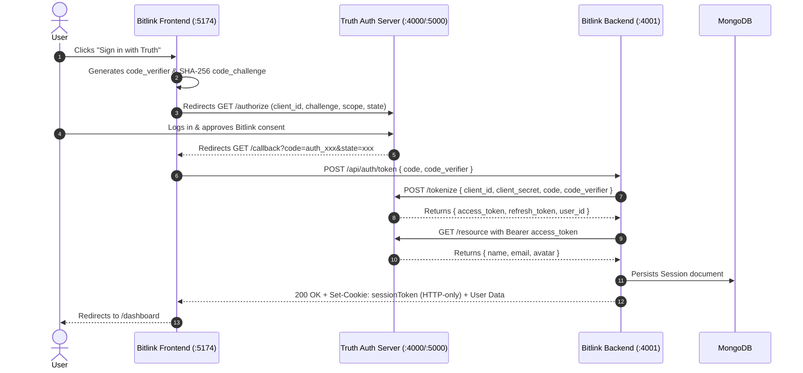
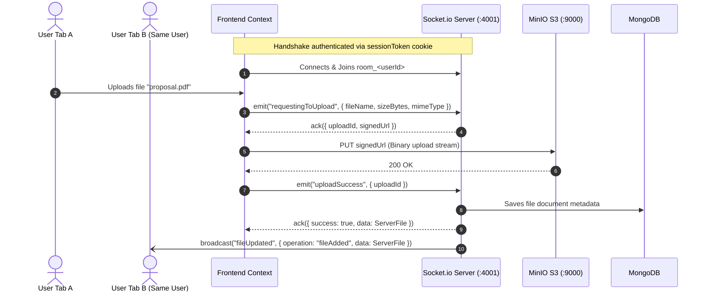

# Bitlink ☁️📁

A high-performance, distributed, Google Drive-style cloud storage and file management platform. Bitlink combines direct-to-object-storage transfers, real-time multi-device WebSocket synchronization, atomic distributed token locking, and enterprise-grade OAuth 2.0 PKCE authentication backed by the standalone **Truth Authorization Server**.

---

## 📑 Table of Contents

- [Overview](#-overview)
- [External Dependency: Truth OAuth Server](#-external-dependency-truth-oauth-server)
- [Key Features](#-key-features)
- [System Architecture](#-system-architecture)
  - [Service Ecosystem](#service-ecosystem)
  - [OAuth 2.0 PKCE Sequence Flow](#oauth-20-pkce-sequence-flow)
  - [Real-Time WebSocket File Operations](#real-time-websocket-file-operations)
- [Technology Stack](#-technology-stack)
- [Project Structure](#-project-structure)
- [Prerequisites](#-prerequisites)
- [Environment Configuration](#-environment-configuration)
  - [Backend Environment (`backend-server/.env`)](#backend-environment-backend-serverenv)
  - [Frontend Environment (`frontend-server/.env`)](#frontend-environment-frontend-serverenv)
- [Installation & Running Locally](#-installation--running-locally)
  - [Step 1: Set Up Truth OAuth Server](#step-1-set-up-truth-oauth-server)
  - [Step 2: Start Infrastructure (MongoDB, Redis, MinIO)](#step-2-start-infrastructure-mongodb-redis-minio)
  - [Step 3: Configure MinIO Bucket](#step-3-configure-minio-bucket)
  - [Step 4: Launch Backend Server](#step-4-launch-backend-server)
  - [Step 5: Launch Frontend Server](#step-5-launch-frontend-server)
  - [Running Entire Stack via Docker Compose](#running-entire-stack-via-docker-compose)
- [API & WebSocket Reference](#-api--websocket-reference)
  - [REST API Endpoints](#rest-api-endpoints)
  - [WebSocket Events (`Socket.io`)](#websocket-events-socketio)
- [Testing & Quality Assurance](#-testing--quality-assurance)
- [Architecture & Coding Standards](#-architecture--coding-standards)
- [License](#-license)

---

## 🌟 Overview

Bitlink is engineered as a modern, decoupled microservice web application:
- **Frontend (`frontend-server`)**: A responsive single-page application built on React 19, TypeScript, Vite, Tailwind CSS v4, and Radix UI / Base UI, providing a Google Drive-inspired file management experience.
- **Backend (`backend-server`)**: A layered Node.js / Express 5 TypeScript microservice orchestrating OAuth 2.0 PKCE verification, MongoDB session persistence, Redis-backed distributed locks, MinIO S3 presigned transfers, and Socket.io real-time event broadcasting.
- **Authentication**: Offloaded to a separate, dedicated OAuth 2.0 authorization server named **Truth** ([github.com/rahuls10x/Truth](https://github.com/rahuls10x/Truth)).

---

## 🔐 External Dependency: Truth OAuth Server

> ⚠️ **IMPORTANT**: Bitlink does **not** manage raw user credentials (passwords, social logins, etc.) internally. It delegates user authentication, consent granting, and identity lifecycle to **Truth**, a custom OAuth 2.0 Authorization Server.

- **Repository**: [https://github.com/rahuls10x/Truth](https://github.com/rahuls10x/Truth)
- **Protocol**: OAuth 2.0 Authorization Code Grant with **PKCE** (Proof Key for Code Exchange) using the `S256` SHA-256 challenge method.
- **Why Truth is Required**:
  - Bitlink frontend initiates authorization redirects directly to Truth (`/authorize`).
  - Bitlink backend performs confidential server-to-server token exchange (`POST /tokenize`) and token rotation (`POST /refresh`).
  - Bitlink fetches authenticated user identity profile (`GET /resource`) from Truth's Resource Server using the opaque access token.

### Setting Up Truth for Bitlink

1. **Clone and Run Truth**:
   Follow instructions at [https://github.com/rahuls10x/Truth](https://github.com/rahuls10x/Truth) to spin up the Truth Authorization Server (default port: `4000`) and Resource Server (default port: `5000`).
2. **Register an Organization & Client Application**:
   - Access the Truth Developer Portal (default port: `5173`).
   - Create a new Client Application under your organization.
   - **Client Name**: `Bitlink`
   - **Redirect URI**: `http://localhost:5174/callback` (or your customized frontend callback URL).
   - **Allowed Scopes**: `name email avatar` (minimum required: `name email`).
3. **Capture Client Credentials**:
   - `Client ID`: A string prefixed with `client_` (e.g., `client_94024474187f4149d2bf682bffdc1fae`).
   - `Client Secret`: A string prefixed with `secret_` (e.g., `secret_demo_template_secret`).
4. **Copy Credentials to Bitlink**:
   Paste the `Client ID` and `Client Secret` into both `backend-server/.env` and `frontend-server/.env` as explained in the [Environment Configuration](#-environment-configuration) section.

---

## ⚡ Key Features

- **Google Drive-Style Workspace**:
  - Intuitive left navigation bar, breadcrumbs, search filtering, and responsive file card grid.
  - File-type specific iconography and metadata (size, upload timestamp, file extension).
  - Quick action menus: view file details, direct browser download, new-tab preview, rename file, and delete file.
- **Direct S3 / MinIO Presigned File Streaming**:
  - Uploads and downloads bypass the backend server memory and CPU bottlenecks.
  - Backend issues short-lived cryptographic presigned S3 URLs (`PutObjectCommand` and `GetObjectCommand`) directly to the client.
- **Real-Time WebSocket Synchronization**:
  - Full Socket.io integration authenticated during the initial WebSocket handshake via HTTP-only session cookies.
  - User-isolated communication rooms (`room_<userId>`).
  - Concurrent tab/device file mutation broadcasts (`fileUpdated`: `fileAdded`, `fileRenamed`, `fileDeleted`).
  - Instant optimistic local UI updates upon acknowledgment (`ack`) for the initiating client.
- **Hardened OAuth 2.0 PKCE Security**:
  - Frontend generates cryptographically random 43–128 character `code_verifier` and derived SHA-256 `code_challenge`.
  - Backend executes confidential authorization code exchange with Truth Auth Server.
  - Tokens (`access_token`, `refresh_token`) never leak to client JavaScript; sessions are tracked via secure HTTP-only cookies (`sessionToken`).
- **Distributed Token Locking & Auto-Rotation**:
  - Redis distributed locking with Lua scripts prevents race conditions during token refresh across concurrent requests.
  - Expired access tokens trigger non-blocking single-winner refresh while pending requests poll and await the new token safely.
- **Centralized Uppy Upload Workflow**:
  - Modular file upload modal with queue management, progress tracking, and validation.

---

## 🏗️ System Architecture

### Service Ecosystem

```
                      ┌──────────────────────────────────────────────┐
                      │             Truth Auth Server                │
                      │    (OAuth 2.0 PKCE + Resource Server)        │
                      │   https://github.com/rahuls10x/Truth         │
                      └──────────────▲─────────────────▲─────────────┘
                         Auth Code   │                 │ Token Exchange &
                         Redirects   │                 │ User Info (/resource)
                                     │                 │
 ┌──────────────────────┐            │      REST       │            ┌──────────────────────┐
 │                      │◄───────────┘    (/tokenize)  └───────────►│                      │
 │   Frontend Server    │                                           │    Backend Server    │
 │  (React 19 + Vite)   │◄─────────── WebSocket (Socket.io) ───────►│  (Node.js + Express) │
 │     Port: 5174       │             Real-time sync                │     Port: 4001       │
 └──────────┬───────────┘                                           └──────────┬───────────┘
            │                                                                  │
            │ Direct Presigned S3                                              │
            │ Uploads & Downloads                                              │
            ▼                                                                  │
 ┌──────────────────────┐                                                      │
 │      MinIO S3        │◄─────────────────────────────────────────────────────┤
 │   Object Storage     │              Generates Presigned URLs                │
 │     Port: 9000       │                                                      │
 └──────────────────────┘                                                      │
                                    ┌──────────────────────┐                   │
                                    │     MongoDB v8       │◄──────────────────┤
                                    │ Sessions & Metadata  │                   │
                                    │    Port: 27018       │                   │
                                    └──────────────────────┘                   │
                                                                               │
                                    ┌──────────────────────┐                   │
                                    │      Redis v8        │◄──────────────────┘
                                    │   Distributed Locks  │
                                    │    Port: 6380        │
                                    └──────────────────────┘
```


### OAuth 2.0 PKCE Sequence Flow



### Real-Time WebSocket File Operations




---

## 🛠️ Technology Stack

| Domain | Technology / Tool | Version | Purpose |
|---|---|---|---|
| **Frontend Framework** | [React](https://react.dev/) | 19.2 | Client component rendering & state architecture |
| **Build Tooling** | [Vite](https://vitejs.dev/) | 8.3 | Ultra-fast client development server & bundling |
| **UI Primitives** | [Tailwind CSS](https://tailwindcss.com/) & [Base UI](https://base-ui.com/) | v4.3 / v1.8 | Utility-first styling & accessible headless UI components |
| **Icons & Utilities** | [Lucide React](https://lucide.dev/) | 1.45 | Scalable modern icon set |
| **File Upload Client** | [Uppy Core](https://uppy.io/) | 6.3 | Modular file selection, validation, and queue control |
| **Real-time Client** | [Socket.io Client](https://socket.io/) | 4.8 | Bidirectional event synchronization |
| **Backend Runtime** | [Node.js](https://nodejs.org/) & [TypeScript](https://www.typescriptlang.org/) | v20+ / TS 6.0 | Modern TypeScript ESM server execution |
| **HTTP Framework** | [Express](https://expressjs.com/) | 5.2 | RESTful routing, cookie handling, and middleware |
| **Real-time Server** | [Socket.io](https://socket.io/) | 4.8 | WebSocket server with session-based connection guard |
| **Cloud Storage SDK** | [@aws-sdk/client-s3](https://aws.amazon.com/sdk-for-javascript/) | 3.1150 | S3 presigned URL generation and bucket interaction |
| **Database** | [MongoDB Node Driver](https://www.mongodb.com/) | 7.7 | User session and file metadata persistence |
| **Cache & Distributed Lock** | [Redis](https://redis.io/) | 5.12 | Distributed lock management and token exchange caching |
| **Validation** | [Zod](https://zod.dev/) | 4.4 / 4.6 | Strict runtime schema parsing for HTTP & WebSocket inputs |
| **Testing** | [Vitest](https://vitest.dev/) | 4.1 | Unit and integration testing |
| **OAuth 2.0 Provider** | [Truth](https://github.com/rahuls10x/Truth) | 1.0 | External Authorization Server for PKCE authentication |

---

## 📂 Project Structure

```text
bitlink/
├── docker-compose.yml              # Container orchestration for all services
├── docs/                           # Architectural specs and engineering records
│   ├── CONTEXT.md                  # System architecture, flows, and boundaries
│   ├── PROJECT_MAP.md              # File-by-file responsibility registry
│   ├── STYLEGUIDE.md               # Coding standards, JSDoc flow checklist rules
│   ├── DECISIONS.md                # Chronological implementation decision log
│   └── Authentication Wiki.md      # Truth OAuth 2.0 PKCE protocol reference
├── backend-server/                 # Express 5 + TypeScript backend microservice
│   ├── Dockerfile
│   ├── example.env                 # Backend environment variable template
│   ├── package.json
│   ├── tsconfig.json
│   ├── server.ts                   # Application bootstrap and route registration
│   ├── src/
│   │   ├── controllers/            # AuthController, UploadController, FileController
│   │   ├── services/               # AuthService, SessionService, UploadService, FileService
│   │   ├── repositories/           # Mongo and Redis repositories, BucketRepository
│   │   ├── middlewares/            # TokenAuthMiddleware, ValidationMiddlewares
│   │   ├── routes/                 # WebSocket route handlers and room management
│   │   ├── types/                  # Database schemas, socket types, token types
│   │   └── utils/                  # ApplicationError, ValidationSchema, Lua scripts
│   └── tests/                      # Vitest test suites (AuthController, TokenAuthMiddleware)
└── frontend-server/                # React 19 + Vite frontend application
    ├── Dockerfile
    ├── nginx.conf                  # Nginx production configuration for SPA routing
    ├── example.env                 # Frontend environment variable template
    ├── package.json
    ├── vite.config.ts
    └── src/
        ├── App.tsx                 # App entry with router and context providers
        ├── config/                 # Route definitions and constants
        ├── contexts/               # AuthContext, SocketContext, FileContext
        ├── feature/
        │   ├── auth/               # LoginPage, CallbackPage
        │   ├── dashboard/          # DashboardPage overview
        │   └── files/              # FilesPage file manager & browser
        ├── components/             # UploadModal, RenameModal, DeleteConfirmModal, UI primitives
        └── utils/                  # PKCE helper functions (verifier, S256 challenge)
```

---

## 📋 Prerequisites

Before setting up Bitlink, ensure the following are installed:
- [Node.js](https://nodejs.org/) `>= 20.0.0`
- [Docker](https://www.docker.com/) & [Docker Compose](https://docs.docker.com/compose/)
- [Git](https://git-scm.com/)
- An active clone and running instance of [Truth Authorization Server](https://github.com/rahuls10x/Truth)


---

## ⚙️ Environment Configuration

### Backend Environment (`backend-server/.env`)

Create `backend-server/.env` based on `backend-server/example.env`:

```ini
# Bitlink Express Port
PORT=4001

# Allowed Frontend Origin (for CORS and WebSocket connections)
ORIGIN_URL="http://localhost:5174"

# Truth OAuth 2.0 Server Endpoints
AUTH_SERVER_URL="http://localhost:4000"
RESOURCE_SERVER_URL="http://localhost:5000"

# OAuth 2.0 Client Credentials (obtained from Truth Developer Portal)
CLIENT_ID="client_94024474187f4149d2bf682bffdc1fae"
CLIENT_SECRET="secret_demo_template_secret"
REDIRECT_URI="http://localhost:5174/callback"

# S3 / MinIO Object Storage Configuration
S3_ENDPOINT="http://localhost:9000"
S3_REGION="us-east-1"
S3_BUCKET_NAME="bitlink-bucket"
S3_ACCESS_KEY_ID="root"
S3_SECRET_ACCESS_KEY="rootpass"

# Database Connections
MONGO_DB="mongodb://localhost:27018/"
REDIS_DB="redis://localhost:6380"
```

| Variable | Description | Default / Example |
|---|---|---|
| `PORT` | Local port for Express and Socket.io server | `4001` |
| `ORIGIN_URL` | Frontend origin allowed for CORS and credentials | `http://localhost:5174` |
| `AUTH_SERVER_URL` | Base URL of Truth Authorization Server | `http://localhost:4000` |
| `RESOURCE_SERVER_URL` | Base URL of Truth Resource Server | `http://localhost:5000` |
| `CLIENT_ID` | OAuth Client ID generated by Truth (starts with `client_`) | `client_...` |
| `CLIENT_SECRET` | OAuth Client Secret generated by Truth (starts with `secret_`) | `secret_...` |
| `REDIRECT_URI` | Exact OAuth callback URL registered in Truth | `http://localhost:5174/callback` |
| `S3_ENDPOINT` | MinIO or AWS S3 API URL | `http://localhost:9000` |
| `S3_REGION` | S3 bucket region | `us-east-1` |
| `S3_BUCKET_NAME` | Name of the storage bucket | `bitlink-bucket` |
| `S3_ACCESS_KEY_ID` | S3 / MinIO Access Key | `root` |
| `S3_SECRET_ACCESS_KEY` | S3 / MinIO Secret Key | `rootpass` |
| `MONGO_DB` | MongoDB connection URI | `mongodb://localhost:27018/` |
| `REDIS_DB` | Redis connection URI | `redis://localhost:6380` |

---

### Frontend Environment (`frontend-server/.env`)

Create `frontend-server/.env` based on `frontend-server/example.env`:

```ini
# OAuth Client ID (must match CLIENT_ID in backend-server/.env)
VITE_CLIENT_ID=client_94024474187f4149d2bf682bffdc1fae

# Frontend OAuth Callback URL
VITE_REDIRECT_URI=http://localhost:5174/callback

# Truth Authorization Endpoint
VITE_AUTH_URL=http://localhost:4000/authorize

# Bitlink Backend API Base URL
VITE_API_URL=http://localhost:4001
```

| Variable | Description | Default / Example |
|---|---|---|
| `VITE_CLIENT_ID` | OAuth Client ID from Truth | `client_...` |
| `VITE_REDIRECT_URI` | SPA redirect callback route | `http://localhost:5174/callback` |
| `VITE_AUTH_URL` | Truth authorization URL to redirect users | `http://localhost:4000/authorize` |
| `VITE_API_URL` | Bitlink backend server URL | `http://localhost:4001` |


---

## 🚀 Installation & Running Locally

### Step 1: Set Up Truth OAuth Server

Before starting Bitlink, launch the **Truth** server on your machine or container host:

```bash
git clone https://github.com/rahuls10x/Truth.git
cd Truth
# Follow Truth repository instructions to start the service
```

Verify that Truth is running on `http://localhost:4000` and its resource server on `http://localhost:5000`. Register an application named **Bitlink** with redirect URI `http://localhost:5174/callback` and paste the generated `client_id` and `client_secret` into your `.env` files.

---

### Step 2: Start Infrastructure (MongoDB, Redis, MinIO)

From the `bitlink` root directory, spin up the database and storage services using Docker Compose:

```bash
docker compose up mongo redis minio -d
```

Service mapping:
- **MongoDB**: `localhost:27018`
- **Redis**: `localhost:6380`
- **MinIO S3 API**: `localhost:9000`
- **MinIO Web Console**: `http://localhost:9001` (Credentials: `root` / `rootpass`)

---

### Step 3: Configure MinIO Bucket

1. Open the MinIO Console in your browser: [http://localhost:9001](http://localhost:9001).
2. Log in with Username: `root`, Password: `rootpass`.
3. Click **Create Bucket**, name it `bitlink-bucket`, and save.

---

### Step 4: Launch Backend Server

```bash
cd backend-server

# Install dependencies
npm install

# Start in development mode (with live reload)
npm run dev
```

The backend server will start on `http://localhost:4001`. You should see:
```text
MongoDB Connected Successfully
Redis Connected Successfully
Backend server listening on port 4001
```

---

### Step 5: Launch Frontend Server

Open a new terminal window:

```bash
cd frontend-server

# Install dependencies
npm install

# Start Vite dev server on port 5174
npm run dev -- --port 5174
```

Navigate your browser to [http://localhost:5174](http://localhost:5174). Click **Sign in with Truth** to test the complete OAuth 2.0 PKCE authentication flow!

---

### Running Entire Stack via Docker Compose

To launch Bitlink (frontend, backend, databases, storage) in full containerized mode:

```bash
docker compose up --build
```

- **Frontend**: `http://localhost:5174`
- **Backend**: `http://localhost:4001`
- **MinIO Console**: `http://localhost:9001`

*(Make sure Truth OAuth server is reachable on your network at the configured `AUTH_SERVER_URL`)*.


---

## 📡 API & WebSocket Reference

### REST API Endpoints

| Method | Endpoint | Auth Required | Description |
|---|---|---|---|
| `GET` | `/health` | No | Health check returning service status and timestamp |
| `POST` | `/api/auth/token` | No | Exchanges authorization `code` and `code_verifier` for session cookie |
| `GET` | `/api/auth/me` | Yes (`sessionToken`) | Retrieves authenticated user profile (`name`, `email`, `avatar`) |
| `POST` | `/api/auth/logout` | Yes (`sessionToken`) | Invalidates session in MongoDB and clears `sessionToken` cookie |
| `GET` | `/api/example/protected` | Yes (`sessionToken`) | Verification endpoint for active session validity |

#### Token Exchange Request (`POST /api/auth/token`)
```json
{
  "code": "auth_a1b2c3d4e5f6a7b8c9d0e1f2a3b4c5d6",
  "code_verifier": "dBjftJeZ4CVP-mB92K27uhbUJU1p1r_wW1gFWFOEjXk"
}
```

---

### WebSocket Events (`Socket.io`)

Bitlink uses Socket.io for all file management operations. Handshake connections are guarded by `sessionToken` cookie authentication.

#### Client-Emitted Events

| Event | Payload | Acknowledgment (`ack`) Response | Description |
|---|---|---|---|
| `viewFiles` | `{}` | `{ success, data: ServerFile[] }` | Retrieves the authenticated user's file inventory |
| `requestingToUpload` | `{ fileName, mimeType, sizeBytes }` | `{ success, data: { uploadId, signedUrl, expiresAt } }` | Authorizes an upload and generates an S3 PUT presigned URL |
| `uploadSuccess` | `{ uploadId }` | `{ success, data: ServerFile }` | Finalizes file creation; triggers real-time room broadcast |
| `uploadFailed` | `{ uploadId }` | `{ success, message }` | Cancels pending upload record and purges partial S3 binary |
| `requestingToDownload` | `{ fileId }` | `{ success, data: { signedUrl, expiresAt } }` | Generates short-lived S3 GET presigned URL for preview/download |
| `renameFile` | `{ fileId, newFileName }` | `{ success, message }` | Renames the file; triggers real-time room broadcast |
| `deleteFile` | `{ fileId }` | `{ success, message }` | Permanently deletes file metadata and S3 binary |

#### Server-Emitted Broadcasts

| Event | Operation | Payload | Recipient |
|---|---|---|---|
| `fileUpdated` | `fileAdded` | `{ operation: "fileAdded", data: ServerFile }` | Other active sockets in `room_<userId>` |
| `fileUpdated` | `fileRenamed` | `{ operation: "fileRenamed", data: { fileId, newFileName } }` | Other active sockets in `room_<userId>` |
| `fileUpdated` | `fileDeleted` | `{ operation: "fileDeleted", data: { fileId } }` | Other active sockets in `room_<userId>` |

---

## 🧪 Testing & Quality Assurance

Bitlink includes a Vitest test suite for backend controllers and middleware.

```bash
cd backend-server

# Run unit tests
npm test -- --run

# Run linter
npm run lint
```

```bash
cd frontend-server

# Run frontend linter
npm run lint

# Build production bundle
npm run build
```

---

## 📖 Architecture & Coding Standards

All contributions to Bitlink follow rigorous internal standards documented under the `docs/` directory:
- **`docs/CONTEXT.md`**: Up-to-date system architecture, data models, state flows, and environment boundaries.
- **`docs/PROJECT_MAP.md`**: Directory and file responsibility index.
- **`docs/STYLEGUIDE.md`**: Conventions for layered dependency injection, JSDoc flow checklists, and explicit ES module imports.
- **`docs/DECISIONS.md`**: Chronological decision log detailing all architectural and code changes.
- **`docs/Authentication Wiki.md`**: Reference manual for Truth OAuth 2.0 PKCE protocol specifications.

---

## 📄 License

This project is licensed under the [MIT License](LICENSE).
Bitlink integrates with [Truth](https://github.com/rahuls10x/Truth), an open-source OAuth 2.0 authorization server.

